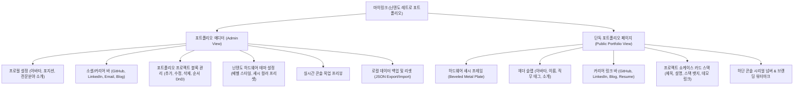

# [PRD & 기능 정의서] 마이링크 (MyLink) - 닌텐도 레트로 하드웨어 포트폴리오 MVP v1.3

> **문서 버전:** 1.3.0  
> **상태:** 확정 (shadcn/ui 기반 레트로 디자인 시스템 포트폴리오 MVP)  
> **컨셉 & 디자인:** shadcn/ui 기반 커스텀 닌텐도 2001 하드웨어 콘솔 디자인 시스템 (메탈릭 베벨 패널, 카본 섀시, 시그널 오렌지/앰버 액센트)  
> **개편 방향:** 강조 애니메이션(Pulse/Shake) 제거, **shadcn/ui 및 Tailwind CSS v4 기반 UI 컴포넌트 표준화**, 포트폴리오 중심 링크 모음 구조 구축  
> **작성일:** 2026-10-27  

---

## 1. 프로젝트 개요 및 기획 배경

### 1.1 서비스 개요
**‘마이링크(MyLink)’**는 2000년대 초 닌텐도 콘솔 하드웨어(Game Boy, GameCube) 특유의 인젝션 몰딩 메탈릭 베벨 플레이트 감성을 현대적으로 재해석한 **포트폴리오 특화 링크인바이오(Link-in-bio) 솔루션**입니다.  
자극적인 깜빡임이나 강조 애니메이션 없이, 견고하고 단정한 콘솔 하드웨어 패널 위에 자신의 대표 프로젝트, 기술 스택, 커리어 링크, 소셜 연락처를 체계적으로 진열합니다.

### 1.2 핵심 변경 사항 (v1.3)
- **shadcn/ui 기반 디자인 시스템 표준화:**
  - UI 컴포넌트(Button, Card, Badge, Input, Switch, Dialog, Tabs 등)를 **shadcn/ui**를 기반으로 구현 및 확장하여 접근성(Accessibility)과 일관된 디자인 시스템 인터페이스 확보.
  - 최신 **Tailwind CSS v4**의 CSS-first 아키텍처(`@theme`, CSS 변수 기반 컬러 토큰)를 전면 적용.
- **강조 애니메이션 완전 제거:** 펄스(Pulse), 흔들림(Shake) 등의 시선 분산 애니메이션을 전면 배제하고, 차분하고 신뢰감 있는 포트폴리오 룩 구현.
- **포트폴리오 정보 구조 강화:** 단순 단일 링크 나열에서 벗어나, [프로젝트명 / 간략한 역할 및 설명 / 기술 스택 칩 / 프로젝트 링크] 형태의 포트폴리오 카드 컴포넌트 도입.
- **닌텐도 2001 디자인 시스템 접목:**
  - 본체 섀시: 페리윙클 메탈릭(`canvas`: `#7a8aba`) 베벨 플레이트 (상단 하이라이트 + 하단 인디고 그림자 라인)
  - 커맨드 바 & 네비: 카본 블랙/네이비(`carbon`: `#21242e`) 슬랩
  - 신호/액션 칩: 시그널 오렌지(`signal`: `#f68d1f`), 앰버 골드(`amber`: `#ecab37`)

---

## 2. 사용자 시나리오 (User Scenarios)

### 2.1 방문자 관점: 포트폴리오 탐색 과정
1. **[포트폴리오 링크 진입]**  
   **사용자는** 구인 담당자 또는 협업 제안자로서 작업자의 이력과 작업물을 검토하기 위해, 이력서나 깃허브 프로필에 기재된 마이링크 URL을 클릭한다.
2. **[아이덴티티 & 포지션 확인]**  
   **사용자는** 작업자의 전문 분야와 첫인상을 파악하기 위해, 상단의 프로필 아바타, 포지션 명칭(예: *Frontend Engineer / UI Designer*), 전문 기술 태그를 확인한다.
3. **[공식 소셜/이력서 링크 확인]**  
   **사용자는** 작업자의 상세 이력이나 소스 코드를 열람하기 위해, 상단 소셜 퀵바의 GitHub, LinkedIn, 이메일, 기술 블로그 링크를 클릭한다.
4. **[주요 프로젝트 쇼케이스 탐색]**  
   **사용자는** 작업자가 주도한 핵심 프로젝트의 완성도와 사용 기술을 파악하기 위해, 베벨 패널로 단정하게 정리된 프로젝트 카드(프로젝트명, 설명, 기술 태그)를 순차적으로 스크롤하며 검토한다.
5. **[라이브 데모 및 상세 저장소 이동]**  
   **사용자는** 실제 배포된 서비스 데모나 깃허브 저장소를 확인하기 위해, 프로젝트 카드 우측의 시그널 오렌지 이동 버튼(`[DEMO >]`, `[GITHUB >]`)을 탭하여 새 창으로 열람한다.

### 2.2 소유자 관점: 포트폴리오 관리 과정 (추가, 수정, 삭제)
1. **[에디터 접속]**  
   **사용자는** 최근 완료한 사이드 프로젝트를 포트폴리오에 추가하고 경력을 갱신하기 위해, 마이링크 관리자 편집기(Editor)에 접속한다.
2. **[프로젝트 카드 추가]**  
   - **사용자는** 신규 프로젝트를 등록하기 위해, 프로젝트 관리 탭의 **[+ 새 프로젝트 카드 추가]** 버튼을 클릭한다.
   - **사용자는** 작업물의 개요를 명확히 전달하기 위해, 프로젝트 타이틀(예: *"Nintendo Web Studio"*), 한 줄 설명, 사용 기술 스택 태그(예: `Next.js`, `TypeScript`, `Tailwind`), 배포 데모 URL을 입력한다.
3. **[실시간 콘솔 목업 검증]**  
   **사용자는** 새로 작성한 프로젝트 카드가 닌텐도 하드웨어 패널 비율에 맞추어 깔끔하게 정렬되는지 확인하기 위해, 우측 실시간 라이브 목업 화면을 확인한다.
4. **[대표 프로젝트 순서 조정 (DnD)]**  
   **사용자는** 가장 완성도가 높은 메인 프로젝트를 포트폴리오 최상단에 배치하기 위해, 해당 카드의 드래그 핸들을 잡고 맨 위로 재배치한다.
5. **[기존 프로젝트 정보 수정 및 최신화]**  
   **사용자는** 기존 프로젝트의 배포 주소가 변경되었거나 설명 문구를 다듬기 위해, 해당 프로젝트 카드를 클릭하여 내용을 수정한다.
6. **[오래된 프로젝트 삭제]**  
   **사용자는** 자신의 현재 기술 스택과 맞지 않는 초창기 토이 프로젝트를 정리하기 위해, 카드 우측 상단의 삭제 아이콘을 클릭하여 정리한다.
7. **[최종 완성본 점검]**  
   **사용자는** 채용 담당자 시점의 단독 포트폴리오 화면을 최종 점검하기 위해, 상단의 **[완성된 페이지 보기]** 버튼을 눌러 확인한다.

---

## 3. 정보 구조도 (Information Architecture)



---

## 4. 세부 기능 정의서 (Functional Specifications)

### [모듈 1] 프로필 및 커리어 소셜 바 (Profile & Career Links)

| 기능 ID | 기능명 | 상세 요구사항 |
| :--- | :--- | :--- |
| **PROF-01** | 프로필 및 포지션 명세 | • 프로필 이미지: 정사각/원형 크롭, 닌텐도 하드웨어 베벨 테두리 프레임 적용<br>• 표시 이름 및 영문 핸들 (예: *이지민 / @jimin.dev*)<br>• 주 포지션 타이틀 (예: *Frontend Engineer & Creative Developer*)<br>• 핵심 소개글 (최대 140자, 전문 역량 및 지향점 기술) |
| **PROF-02** | 커리어 소셜 퀵바 | • 개발/디자인 포트폴리오에 필수적인 소셜 플랫폼 전용 지원<br>• 지원 플랫폼: **GitHub, LinkedIn, Tech Blog(Velog/Tistory/Medium), Email, Figma, X**<br>• 메탈릭 캡슐 버튼 형태로 렌더링되며 클릭 시 새 탭 이동 |

---

### [모듈 2] 포트폴리오 프로젝트 블록 (Portfolio Project Cards)

| 기능 ID | 기능명 | 상세 요구사항 |
| :--- | :--- | :--- |
| **PROJ-01** | 프로젝트 카드 등록/수정 | • **프로젝트 타이틀:** 서비스명 및 부제 (최대 30자)<br>• **설명(Description):** 프로젝트 핵심 역할, 문제 해결 내용 (최대 100자)<br>• **기술 스택 태그:** 콤마(,) 또는 태그 입력으로 다중 스택 배지 등록 (예: `React`, `TypeScript`, `Next.js`)<br>• **액션 링크:** 라이브 데모 URL 및 GitHub 저장소 URL 개별 등록 지원<br>• **폼 UI:** shadcn/ui `Input`, `Textarea`, `Button` 컴포넌트를 닌텐도 베벨 테마로 커스터마이징하여 사용 |
| **PROJ-02** | 단정하고 정돈된 카드 UI (No Animation) | • shadcn/ui `Card` 컴포넌트를 확장하여 닌텐도 베벨 플레이트 형태의 단정하고 일관된 직사각형 메탈릭 카드 디자인 구현<br>• 기술 스택 칩은 shadcn/ui `Badge` 컴포넌트 기반<br>• 좌측: 카테고리 인디케이터 도트 + 프로젝트명 + 설명 + 기술 스택 칩<br>• 우측: 시그널 오렌지 색상의 shadcn/ui `Button` 기반 이동 액션 버튼(`DEMO >`, `CODE >`) |
| **PROJ-03** | 순서 변경 (DnD) | • 드래그 앤 드롭으로 프로젝트 우선순위 상하 자유 배치<br>• 변경 즉시 LocalStorage에 순서 동기화 |
| **PROJ-04** | 노출/숨김 토글 | • shadcn/ui `Switch` 컴포넌트를 활용하여 완료된 메인 프로젝트만 선별 노출할 수 있도록 개별 On/Off 스위치 제공 |

---

### [모듈 3] 닌텐도 레트로 테마 & 스타일링 (Nintendo Design System × shadcn/ui)

| 기능 ID | 기능명 | 상세 요구사항 |
| :--- | :--- | :--- |
| **THM-01** | shadcn/ui 기반 컴포넌트 시스템 | • 모든 UI 컴포넌트는 **shadcn/ui**를 기반으로 구현하고, 닌텐도 레트로 테마에 맞게 CSS 변수 및 Tailwind CSS v4 `@theme`을 통해 커스터마이징<br>• 사용 컴포넌트: `Button`, `Card`, `Badge`, `Input`, `Textarea`, `Switch`, `Dialog`, `Tabs`, `Avatar`, `Tooltip` 등<br>• shadcn/ui의 접근성(WAI-ARIA) 기본 지원을 그대로 활용 |
| **THM-02** | 하드웨어 섀시 프리셋 | • **Classic Periwinkle 2001 (기본):** 닌텐도 2001년 브러시드 페리윙클 메탈(`#7a8aba`) + 인디고 그림자 라인<br>• **GameCube Indigo:** 딥 인디고 퍼플 섀시 + 블랙 커맨드 슬랩<br>• **Game Boy Platinum:** 쿨 그레이/실버 메탈릭 섀시 + 클래식 그레이 패널 |
| **THM-03** | 베벨 & 챔퍼 지오메트리 | • 모든 카드와 패널은 상단 1px 하이라이트(White/Light)와 하단 1px 다크 인디고 섀도우를 가진 입체적 베벨(Beveled) 플레이트로 렌더링<br>• 모서리는 둥근 라운드가 아닌 각진 형태 또는 45도 챔퍼(Chamfered cut-corner) 적용 |
| **THM-04** | 폰트 & 타이포그래피 | • 깔끔한 시스템 산세리프(Arial / Pretendard) 베이스에 대문자(Uppercase) 트래킹 및 마이크로 라벨 적용<br>• 서브 라벨에는 픽셀 감성의 모노스페이스 서체(Silkscreen / monospace) 조화 |

---

### [모듈 4] 로컬 스토리지 데이터 관리 (LocalStorage)

| 기능 ID | 기능명 | 상세 요구사항 |
| :--- | :--- | :--- |
| **DATA-01** | 자동 저장 & 동기화 | • Zustand `persist` 미들웨어로 브라우저 `localStorage`(`mylink_nintendo_portfolio`)에 즉시 저장 |
| **DATA-02** | 개발자 포트폴리오 기본 샘플 | • 최초 접속 시 기본으로 멋진 닌텐도 감성 개발자 포트폴리오(대표 프로젝트 3개, GitHub/LinkedIn/블로그 링크 포함) 자동 주입 |
| **DATA-03** | JSON 백업 및 리셋 | • 포트폴리오 데이터 백업(JSON 다운로드) 및 초기화(기본값 복원) 지원 |

---

## 5. 로컬 스토리지 데이터 스키마 (JSON Schema)

```json
{
  "profile": {
    "name": "이지민 (Jimin Lee)",
    "handle": "jimin.dev",
    "role": "Frontend & Creative Developer",
    "bio": "웹 표준과 레트로 하드웨어 인터페이스를 사랑하는 프론트엔드 개발자입니다. 몰입감 높은 인터랙티브 웹을 만듭니다.",
    "avatarUrl": "https://images.unsplash.com/photo-1534528741775-53994a69daeb?w=300",
    "location": "Seoul, KR"
  },
  "socials": [
    { "id": "s1", "platform": "github", "url": "https://github.com", "label": "GITHUB", "isActive": true },
    { "id": "s2", "platform": "linkedin", "url": "https://linkedin.com", "label": "LINKEDIN", "isActive": true },
    { "id": "s3", "platform": "blog", "url": "https://velog.io", "label": "TECH BLOG", "isActive": true },
    { "id": "s4", "platform": "email", "url": "mailto:jimin@dev.io", "label": "CONTACT", "isActive": true }
  ],
  "projects": [
    {
      "id": "proj_1",
      "title": "Nintendo 2001 Web Studio",
      "category": "WEB APPLICATION",
      "description": "2000년대 초반 닌텐도 하드웨어 베벨 디자인 시스템을 복원한 인터랙티브 컴포넌트 라이브러리",
      "tags": ["Next.js", "TypeScript", "Tailwind CSS"],
      "demoUrl": "https://demo.mylink.io",
      "githubUrl": "https://github.com/jimin/nintendo-studio",
      "isActive": true
    },
    {
      "id": "proj_2",
      "title": "Pixel Sprite Animator",
      "category": "CREATIVE TOOL",
      "description": "웹 캔버스 기반 레트로 도트 스프라이트 추출 및 실시간 프레임 애니메이션 프리뷰 툴",
      "tags": ["React", "HTML5 Canvas", "Zustand"],
      "demoUrl": "https://sprite.mylink.io",
      "githubUrl": "https://github.com/jimin/sprite-animator",
      "isActive": true
    },
    {
      "id": "proj_3",
      "title": "Cloud Dashboard System",
      "category": "B2B PLATFORM",
      "description": "대용량 실시간 서버 모니터링 및 리소스 사용량 집계 대시보드 UI 엔지니어링",
      "tags": ["React", "TanStack Query", "Recharts"],
      "demoUrl": "https://cloud.mylink.io",
      "githubUrl": null,
      "isActive": true
    }
  ],
  "theme": {
    "preset": "classic-periwinkle",
    "chassisColor": "#7a8aba",
    "plateColor": "#8ba1d4",
    "shadowColor": "#3d4f97",
    "accentColor": "#f68d1f"
  }
}
```

---

## 6. 기술 스택 (Tech Stack)

| 영역 | 기술 | 비고 |
| :--- | :--- | :--- |
| **프레임워크** | Next.js 16 (App Router, Turbopack) | React 19 기반 |
| **UI 컴포넌트** | **shadcn/ui** (v4, base-nova 스타일) | 모든 UI 컴포넌트의 기반. 닌텐도 레트로 테마로 커스터마이징하여 사용 |
| **스타일링** | Tailwind CSS v4 (CSS-first, `@theme` 기반) | `tailwind.config.js` 없이 CSS 변수로 관리 |
| **아이콘** | Lucide React | shadcn/ui 기본 아이콘 라이브러리 |
| **상태 관리** | Zustand + `persist` 미들웨어 | LocalStorage 동기화 |
| **유틸리티** | class-variance-authority (CVA), cn() | 컴포넌트 Variant 관리 |
| **언어** | TypeScript 5 | 전체 코드 타입 안전성 보장 |

---

## 7. 향후 로드맵 (Post-MVP)

- **Phase 2 (포트폴리오 확장):** PDF 이력서 다운로드 버튼 연동, 프로젝트 상세 모달(스크린샷 갤러리 지원)
- **Phase 3 (배포 및 고유 도메인):** GitHub Pages 또는 Vercel 원클릭 정적 배포 지원
